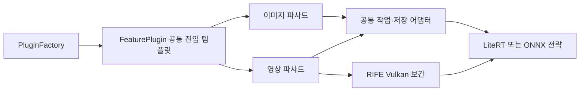

# 플러그인과 필수 호환 기반

선택 기능은 같은 APK에 빌드되는 내장 플러그인이다. 최초에는 모두 꺼져 있으며 관리 화면에서 하나씩 활성화한다. 필수 호환 플러그인은 항상 활성화되어 있고 사용자가 끌 수 없다.

| 구분 | ID | 담당 기능 | 폴더 |
| --- | --- | --- | --- |
| 필수 | 호환 기반 | 기존 데이터 형식, 파일 검증·저장소·이력, 공통 설정·옵션 UI, 원본과 확장 실행 연결 | `compatibility/`, `runtime/` |
| 선택 | SOCIAL | 게시물 이미지·영상 분석, 혼합 게시물 선택, 인스타그램·틱톡 | `image/`, `instagram/`, `tiktok/` |
| 선택 | LIST | 별도 목록 화면, 계정 조회, 이미지·영상 선택, 전체 다운로드 | `listdownload/` |
| 선택 | MEDIA | 파일 재사용, AV1 변환, 컨테이너 선택 | `media/` |
| 선택 | LIBRARY | 미디어 폴더, 이미지·영상 해상도별 분류, 이력 필터·파일 관리·자체 뷰어 | `library/` |
| 선택 | QUEUE | 대기열 묶음·상세 정보, 5개씩 표시, 선택·삭제, 자체 뷰어 | `queue/` |
| 선택 | INTERACTION | 통합 입력, 메뉴 즐겨찾기, 빠른 쿠키 선택 | `interaction/` |
| 선택 | IMAGE_AI | 이미지 보정·업스케일, 모델 관리, 원본·결과 비교와 저장 | `enhancement/` |
| 선택 | VIDEO_AI | QuickSRNet 영상 해상도 개선·RIFE GPU 프레임 보간 | `videoenhancement/` |
| 선택 | SHARE_MENU | Android 공유 메뉴의 빠른 다운로드·앱 화면 선택 | `sharemenu/` |
| 선택 | ACCOUNTS | 자주 방문하는 계정·받은 게시글 수 정렬 | `instagram/` |
| 선택 | POST_INFO | 게시글 설명·링크·저장 메타데이터 | `instagram/` |
| 선택 | FOLDERS | 기본 디렉터리 안의 기존 저장폴더 등록·요청별 선택 | `folders/` |
| 선택 | FACE_SORT | YuNet·MediaPipe 얼굴 판별과 얼굴 없는 이미지의 NOFACE 분류 | `faces/` |

## 원본 보존

비교 기준은 JunkFood 원본 커밋 `7677f61a20fda4210e84215fef9e9b51d25daa47`이다. 원본 `DownloaderV2Impl`에는 선택 기능 구현·참조를 두지 않는다. 원본 다운로드 설정 창과 탐색 메뉴도 복원하고 앞쪽에서 확장 화면에 전달한다. 추가 설명·주석·README는 원본 폴더에 두지 않는다.

`App`에서 주입하는 `PluginDownloaderV2`는 원본 엔진과 확장 엔진이 같은 작업 저장소·코루틴을 쓰도록 연결한다. 새 요청은 `PluginPolicy`로 제한하고, 실행 경로는 작업 사본의 `socialProcessing`, `listProcessing`, `queueEnhancements`, 미디어 설정 및 기존 소셜 작업 유형으로 결정한다. 스위치 변경 시 객체나 진행 중인 작업의 설정을 교체하지 않는다.

원본 경로에는 설정·작업·상태 모델과 Room 스키마, 데이터 접근 API가 호환 계약으로 남는다. 설정 생성·파일 처리·이력 복구의 확장 구현은 필수 기반에 전달한다. DB 모델까지 이전 버전으로 되돌리거나 타입 이름을 임의 변경하면 기존 데이터를 읽지 못하므로 이를 원본 복원의 대상으로 삼지 않는다.

## 선택 기능의 독립성

선택 플러그인은 다른 선택 플러그인의 클래스나 함수를 직접 참조하지 않는다. 공통 API는 필수 기반을 사용하고 실행 등록은 `runtime/`이 담당한다. `FeaturePlugin`은 메뉴와 화면 진입 규약이며 목록 등록은 조합을 담당하는 진입점이다.

LIST는 SOCIAL을 켜지 않아도 계정과 이미지 목록을 처리한다. LIBRARY와 QUEUE의 게시글 뷰어는 필수 `compatibility/PostMediaViewer`를 공유한다. 공통 파일 엔진·메타데이터·계산 규칙·다운로드 옵션 UI도 필수 기반에서 제공한다.

## 개발자용 공통 계약

| 패턴 | 계약 | 역할 |
| --- | --- | --- |
| 파사드 | `FeaturePlugin` | 기능별 메뉴·화면·미디어 작업 진입점 |
| 팩토리 | `PluginFactory.create(id)` | 등록된 기능의 기존 인스턴스 조회 |
| 전략 | `PluginFactory.enabled()` | 현재 활성 기능의 처리 전략 선택 |
| 템플릿 | `FeaturePlugin.Content()` → `RenderContent()` | 공통 활성 검사 후 기능 화면 실행 |
| 어댑터 | `folderAwareDownloader()` | 원본 형식 선택을 요청별 옵션에 연결 |

필수 공통 영역은 `compatibility/`와 `runtime/`이며 스위치로 비활성화하지 않는다. 새 기능은 `FeaturePlugin()`을 상속하고 `RenderContent()`와 필요한 작업 훅만 구현한 뒤 팩토리 목록에 등록한다.

| 공통 API | 용도 |
| --- | --- |
| `createPluginPreferences()` | 저장된 설정의 새 요청 사본 |
| `copyPreservingPluginOptions()` | 기본 필드를 바꿀 때 확장 옵션 보존 |
| `copyPluginOptions()` | 요청의 확장 옵션 변경 |
| `storedPluginOptions()` | 백업할 확장 옵션 조회 |
| `DownloadFormatButton()` | 한 줄 형식·모두 다운로드 선택 |
| `AdditionalSettings()` | 쿠키·폴더·미디어 옵션 UI |
| `PostMediaViewer()` | 사진·영상·제스처·재생 UI |
| `MediaLibrary.listVideos()` | NOFACE 포함 라이브러리 읽기 |
| `MediaLibrary.findExisting()` | 게시글의 실제 파일 검색 |
| `MediaLibrary.resolveDownloadedPath()` | 이동한 파일 경로 복구 |
| `MediaLibrary.classify()` | NOFACE 제외 화질 폴더 분류 |
| `PluginDatabaseUtil.updateMediaPath()` | 이력·메타데이터 경로 갱신 |
| `MediaRules.isNoFacePath()` | 변경 작업의 NOFACE 제외 판단 |
| `PluginMediaMetadataStore.isProcessingExcluded()` | 불투명 SAF ID를 포함한 NOFACE 작업 제외 |
| `ImagePluginActions()` | 활성 이미지 전략의 뷰어 작업 |
| `VideoPluginActions()` | 활성 영상 전략의 뷰어 작업 |
| `EnhancementModels.scan()` | 이미지·영상 공유 모델 목록 |
| `ModelSettings(video)` | 공통 모델·장치·다운샘플링 설정 |
| `EnhancementClient.enhanceVideo()` | 영상 작업 사본·격리 실행 |
| `EnhancementFiles.save()` | 검증 후 교체·복제·이력 갱신 |
| `ImageTiles.process()` | LiteRT·ONNX 공통 타일 처리 |
| `SamplingSettings()` | 기본 양선형·최근접·영역 평균 선택 |
| `FrameSettings()` | 원본 유지·24/25/30/50/60 FPS 선택 |
| `ShareMenuSettings.synchronize()` | 공유 전용 별칭의 활성 상태 동기화 |
| `RifeSession.interpolate()` | 두 원본 프레임 사이 Vulkan GPU 보간 |

NOFACE는 읽기·게시글 연결을 허용하고 파일 변경 작업에서만 제외한다. 요청 옵션은 객체 식별 기준의 약한 키로 보관하므로 같은 값의 요청끼리 쿠키·폴더 옵션을 공유하지 않는다.

공유 메뉴 기본값은 빠른 다운로드 하나다. SHARE_MENU를 켜면 빠른 다운로드·앱 화면 중 최소 하나를 선택한다. 공유 별칭만 변경하므로 실행 아이콘·기존 명시적 진입점은 유지한다. Android가 다른 앱과 함께 표시하는 시스템 공유 창은 OS가 관리한다. 오류 화면의 로그 보기는 로컬 오류 스택을 표시하며 쿠키 재시도는 새 요청의 기본값을 바꾸지 않는다.

QUEUE의 기존 작업 모델·백업 타입은 직렬화 호환 계약이다. 선택 대기열 UI와 공통 실행 모델을 구분하며 타입 이름을 변경하지 않는다.

공통 AI 구현은 `compatibility/enhancement/`에 둔다. 선택 플러그인은 설정·뷰어 작업만 연결한다. QuickSRNet Small은 영상 기본·최소, Medium은 간편 최대이며, 직접 선택에서는 이미지와 같은 Real-ESRGAN 파일을 사용할 수 있다. 프레임 증가만 RIFE Vulkan을 사용하며 소프트웨어 Vulkan을 실제 GPU로 표시하지 않는다. 모델은 첫 보간 시 약 10MB를 받는다. NPU 런타임은 선택 시 약 41MB를 별도 다운로드하며 GPU·CPU 사용에는 필요하지 않다.



이 구조는 기능별 실행과 직접 코드 참조의 분리다. 독립 Gradle 모듈·별도 APK·외부 파일 동적 로딩이나 독립 업데이트 구조는 아니다. 기능을 소스에서 제거하려면 조합 진입점의 등록과 호출도 함께 정리해야 한다.

## 검사

새 체크아웃은 `.build/Setup.ps1`로 Android 도구를 준비하고 NDK `29.0.13846066`·CMake `3.22.1` 설치 뒤 `.build/Seal/native/rife/Build.ps1`을 먼저 실행한다. 고정 RIFE/ncnn 소스를 검증하고 네 ABI의 JNI를 `.build/Seal/runtime/rife/jniLibs/`에 만든다. 빌드 캐시·SDK·가중치는 Git과 APK에 포함하지 않는다. APK에는 생성한 JNI·작은 QuickSRNet 모델·라이선스만 넣는다.

```powershell
python -X utf8 .build/Seal/Test-PluginIsolation.py
python -X utf8 .build/Seal/Test-ShareMenu.py
powershell -NoProfile -ExecutionPolicy Bypass -File .build/Seal/Test-Localization.ps1
powershell -NoProfile -ExecutionPolicy Bypass -File .build/Build.ps1 -Offline -Test :app:assembleGenericDebug :app:assembleGenericDebugAndroidTest
```

`PluginExecutionPolicyTest`는 원본 경로, 개별 실행 경로, 작업 사본 유지, LIST 단독 사용을 검사한다. `SharedDownloaderStateTest`는 네트워크를 실행하지 않고 원본 엔진의 공유 저장소·취소·재시작을 검사한다. `PluginStateTest`는 MMKV와 필수 활성화를, `.build/Seal/Test-PluginUi.py`는 변경 불가 호환 항목과 여섯 개 선택 스위치를 검사한다.

번역은 Android 리소스 규칙에 따라 `res/values*/`에 둔다. 소셜 API 접근 제한·로그인 요구, 기기의 인코더·SAF 공급자 차이는 기능 분리만으로 해결되지 않는다.

## 미디어 폴더·페이지 삭제·원본 보존 규칙

폴더 분류는 LIBRARY만 켜도 실행한다. MEDIA는 인코딩·파일 재사용을 담당하며 폴더 설정을 쓰지 않는다. 이미지·영상 구간은 각각 켜고 끈다. 꺼진 구간은 하위 우선 또는 상위 우선으로 사용 중인 가장 가까운 구간을 찾으며, 해당 방향에 없으면 반대 방향을 찾는다. 최소 기준 미달과 모든 구간 비활성은 기본 폴더에 둔다. 구간 설정은 기존 문자열 필드에 비활성 구간을 함께 넣어 등록 작업과 백업의 사본을 유지한다.

LIBRARY와 QUEUE의 뷰어는 삭제 성공 후 넘김 목록에서 해당 파일을 제외한다. 전체 페이지 수는 처음 열었을 때의 수와 이력의 원래 게시물 수 중 큰 값으로 유지한다. 실패한 삭제는 목록을 변경하지 않는다.

Codex는 루트 `AGENTS.md`, Antigravity는 `GEMINI.md`와 `.agent/rules/junkfood-preservation.md`의 항상 적용 규칙을 따른다. `com/junkfood` 소스 수정·추가·삭제·이동·주석·포맷은 금지하며 별도 명시적 허용이 있을 때만 예외를 허용한다.

## 이미지 AI 사용

플러그인 관리에서 이미지 AI 보정을 켜면 내장 Real-ESRGAN Mobile 기본 모델을 사용한다. 추가 추천 ONNX 모델을 내려받거나 파일을 가져올 수도 있다. 다운로드 폴더의 `models`에 넣은 단일 파일 ONNX 모델도 검색한다. 이미지 뷰어 왼쪽 위 마법봉에서 최소·최대 또는 직접 해상도·배율을 선택하고, 미리보기 뒤에 교체·복제로 저장한다.

추론은 별도 프로세스로 실행한다. S25 Edge 실측에서 초기화가 빠른 LiteRT GPU를 기본으로 사용하며 NPU·GPU 자동, ONNX·NNAPI와 CPU를 옵션으로 선택할 수 있다. NPU 자동 프로세스가 종료되면 별도 GPU 프로세스, GPU 프로세스가 종료되면 ONNX CPU 프로세스로 제한된 재시도를 수행한다. 실제 사용 엔진은 진행·결과에 표시하며, 가속기 지원 목록만으로 NPU 실행을 확정하지 않는다. Google 지원 기기는 모듈 설치 뒤 Google 우선 사용도 선택할 수 있다. 어떤 경로도 다운로드 대기열의 실행 잠금을 공유하지 않는다.

## 얼굴 없는 이미지 분류

플러그인 관리에서 얼굴 분류를 켠 뒤 독립 메뉴에서 YuNet 또는 MediaPipe와 분석 해상도를 선택한다. 영상·NOFACE 폴더를 제외한 이미지만 판별하고 얼굴 없는 파일을 이동한다. 단일 폴더는 기본 루트의 NOFACE, 폴더별은 일반 이미지 부모의 NOFACE를 사용한다. 화질 폴더는 스캔하되 목적지 기준에서는 제외하므로 Images/720p의 결과는 Images/NOFACE로 모인다. 원본 바이트는 유지하고 동명 파일은 번호를 붙이며 판독 실패 파일은 이동하지 않는다.

## 저장폴더 목록과 쿠키 갱신

FOLDERS는 기본 영상·음원 디렉터리(또는 비공개·SAF 기본 루트)와 그 하위의 기존 폴더만 등록한다. 화질 폴더와 그 하위·링크는 제외한다. 다운로드창에서 기본 설정을 선택하면 기존 저장 규칙을 쓰고, 폴더를 고르면 웹사이트·종류 폴더를 덧붙이지 않고 그 위치에서 화질 분류를 적용한다. 등록 목록 제외는 실제 파일·폴더를 삭제하지 않는다. 설정 사본은 대기열 백업에 저장한다.

쿠키 오류 복구·최신 데이터 갱신은 필수 호환 기반이다. 전체 쿠키는 WebView의 최신 값을, 직접 선택한 프로필은 해당 DB 레코드의 최신 내용을 사용한다. 직접 선택은 빠른 선택 플러그인과 독립적으로 저장한다. yt-dlp의 요청별 임시 쿠키 파일은 서로 공유하지 않고 완료·실패·조기 반환 후 정리한다. 쿠키 비활성 요청은 쿠키 저장소를 읽거나 전송하지 않는다.

QUEUE 화면은 기본 다섯 게시글부터 표시하고 목록 끝에서 다섯 개씩 추가한다. 시간순·이름순 및 점진 표시 선택은 저장하며 필터·정렬·옵션 변경 시 표시 수를 초기화한다. 표시 제한과 무관하게 전체 선택·삭제는 전체 대상에 적용한다. 전체 게시글 묶음 계산은 백그라운드에서 하고 카드별 실제 작업은 게시글 색인으로 찾는다. 실행 엔진의 복원·스케줄링·백업은 전체 작업을 보존한다.

FOLDERS 등록 카드의 퀵 표시로 한 폴더를 지정하면 다운로드창의 공통 선택 버튼은 목록을 열지 않고 해당 폴더 적용·기본 규칙 복원을 전환한다. 퀵 지정은 저장하며 등록 해제 시 함께 해제한다. 현재 루트와 실제 접근 권한 검증을 통과한 폴더만 적용한다.

퀵 폴더 버튼은 1초 이상 길게 누르면 일반 선택 메뉴를 연다. 길게 누르기는 적용·해제를 함께 실행하지 않는다. 오류 재시도의 쿠키 선택은 현재 요청에만 적용하고 다음 다운로드창의 쿠키 기본값을 변경하지 않는다.

앱 시작·임시 다운로드의 저장 루트는 필수 `StorageDirectories`를 따른다. 비공개 모드에서는 `.Seal`, 공개 모드에서는 지정한 로컬 경로를 사용한다. 원본 FileUtil 소스는 유지하고 AGP 빌드 계측으로 대상 getter 하나의 실행 본문만 연결한다. 검색용 기본 경로 조회는 폴더를 만들지 않는다.

기본 가속 모델은 기존 일반 사진 복원 가중치를 유지한 고정 192픽셀 입력·DCR 배치 모델이다. NNAPI 모바일 호환 검사 70/70 연산을 통과했고 합성 입력의 기존 모델 대비 출력 오차는 0이다. 실제 가속은 기기 드라이버에 따라 달라지며 첫 타일의 NNAPI·CPU 실행 제공자 기록을 보정 중 표시한다. 구간 수는 사용률이나 GPU·NPU별 이용률을 의미하지 않는다. CPU 스레드는 1부터 기기가 보고한 논리 코어 수의 절반까지 저장해 적용한다.

기본 실행 경로는 LiteRT v2의 공통 NPU·GPU API이며 같은 가중치의 ONNX 실행을 선택 옵션과 실패 시 대체 경로로 유지한다. 제조사별 추론 구현 대신 공통 제공자를 사용하고 Qualcomm HTP v79 런타임을 배포한다. LiteRT 공개 API는 연산별 실제 장치 분배를 제공하지 않으므로 경로 실행 완료와 분배 확인 불가를 구분해 표시한다. 두 엔진 모두 ImageTiles의 겹침 타일·경계 제거·결합을 공유하며 가중치 블렌딩은 사용하지 않는다.
